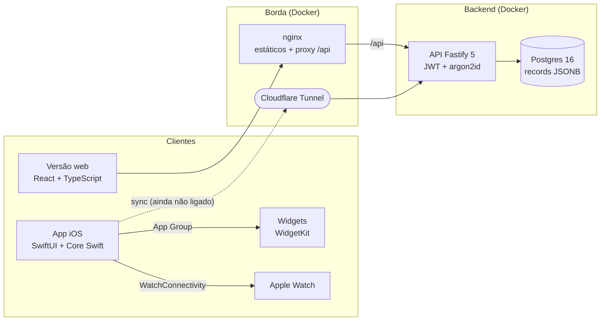

# App Finanças

Aplicativo de gestão financeira **individual e familiar** para o público brasileiro (BRL, PIX, boletos, cartão de crédito com fatura e fechamento). Este repositório reúne o app iOS nativo, a versão web, o backend com banco de dados e toda a documentação.

> **Status:** projeto em desenvolvimento. O app iOS compila, roda no Simulador e já foi instalado em um iPhone 12 de teste. A **sincronização entre app, web e banco ainda não está ligada**: hoje o app iOS guarda os dados só no aparelho. O que foi e o que não foi verificado está descrito em [O que foi verificado](#o-que-foi-verificado).

## Sumário

- [Funcionalidades](#funcionalidades)
- [Arquitetura](#arquitetura)
- [Estrutura do repositório](#estrutura-do-repositório)
- [Como rodar](#como-rodar)
- [Testes](#testes)
- [API e banco de dados](#api-e-banco-de-dados)
- [Segurança e privacidade](#segurança-e-privacidade)
- [O que foi verificado](#o-que-foi-verificado)
- [Limitações conhecidas](#limitações-conhecidas)
- [Roadmap](#roadmap)
- [Documentação](#documentação)

## Funcionalidades

| Área | O que existe |
|---|---|
| **Lançamentos** | Receitas, despesas e transferências; categorias e subcategorias; tags; comprovante em foto; recorrência (mensal, semanal, anual); parcelamento sem perder centavos; busca e filtros; edição e exclusão de parcelas em grupo |
| **Contas e cartões** | Contas corrente, poupança, carteira e investimento, com conciliação; vários cartões com limite, fechamento e vencimento; fatura atual e futuras; pagamento total ou parcial |
| **Planejamento** | Orçamento mensal por categoria com alertas em 80% e 100%; metas com histórico de aportes e projeção; contas a pagar com calendário e lembretes; fluxo de caixa projetado em 30, 60 e 90 dias |
| **Dívidas e investimentos** | Simulador de quitação (avalanche e bola de neve); carteira manual (renda fixa, ações, FIIs, cripto); patrimônio líquido e evolução mensal |
| **Família** | Perfis com papéis (admin, membro, dependente); contas privadas e compartilhadas; divisão de despesas e acerto de contas; mesada; limite e aprovação para dependentes |
| **Relatórios** | Por período, categoria, membro e conta; exportação em CSV e PDF; resumo para Imposto de Renda |
| **Importação** | Extrato OFX e CSV com detecção de duplicadas; leitura de QR de NFC-e; OCR de comprovantes e boletos (linha digitável com dígito verificador) |
| **Insights** | Estatística local e explicável (sem IA externa): gastos atípicos, previsão do saldo no fim do mês, assinaturas detectadas, sugestões de economia |
| **Experiência** | Seletor de mês e ano; puxar para atualizar; Face ID e PIN próprio; widgets; atalho da Siri; modo escuro; Dynamic Type; português do Brasil |
| **Plataformas** | iOS 17+ (SwiftUI), Apple Watch (código, não executado), versão web (React) |

Detalhes por tela estão em [`Design/screens.md`](Design/screens.md).

## Arquitetura



A arquitetura está documentada no **modelo C4** (contexto, contêineres, componentes, implantação e fluxo dinâmico) em [`docs/arquitetura/`](docs/arquitetura/README.md), com imagens e o arquivo editável [`arquitetura-solucao.drawio`](docs/arquitetura/arquitetura-solucao.drawio) (uma página por nível). Outros diagramas (modelo de dados, sincronização, fatura de cartão, pipeline de testes) estão em [`docs/arquitetura.md`](docs/arquitetura.md).

**Decisões principais**

- **Núcleo financeiro em Swift puro** (`FinanceApp/Core`): todo dinheiro é `Decimal`, nunca `Double`. Não importa UI, o que permite testá-lo só com `swiftc`, e o código poderia rodar em um servidor Swift.
- **Regras fora das telas:** as Views só exibem; saldos, faturas, parcelas e orçamentos vêm dos motores do Core.
- **Persistência atrás de um protocolo** (`Repository`): hoje um arquivo JSON local; trocar por SwiftData, CloudKit ou uma API não muda a interface.
- **Banco documental (JSONB):** cada entidade do Core é uma linha, o que espelha o `Repository` e a regra de sincronização por `updatedAt`.
- **Versão web com paridade verificada:** o porte do Core em TypeScript é comparado, por testes, com 365 resultados gerados pelo próprio Core Swift.

## Estrutura do repositório

```
.
├── FinanceApp/            App iOS (SwiftUI) e núcleo financeiro
│   ├── Core/              Regras financeiras (Swift puro, Decimal)
│   ├── CoreTests/         Testes do Core (runner swiftc, sem Xcode)
│   ├── App/               Features, Store, Logic, Services, Design
│   ├── AppTests/          Testes da lógica do app
│   ├── UITests/           XCUITest dos fluxos críticos
│   ├── Widgets/           Extensão WidgetKit
│   ├── Watch/             App e complicação do Apple Watch
│   ├── Assets/            Cores, ícone, Info.plist, privacy manifest
│   ├── scripts/           test-core, test-app, typecheck, capturas
│   ├── project.yml        XcodeGen (completo, com widgets)
│   └── project-free.yml   XcodeGen para conta Apple gratuita
├── Web/                   Versão web (React 18 + TypeScript + Vite)
├── Backend/               API Fastify, migrações SQL, scripts, openapi.yaml
├── docker-compose.yml     db, api, web, túnel (perfis)
├── Design/                Tokens de design, inventário de telas, ícone
├── Prototype/             Protótipo HTML clicável (iPhone 16 Pro Max, 12, 16, SE)
├── Monitor/               Painel local de acompanhamento de agentes
├── docs/                  Documentação, diagramas, capturas
├── PROMPT.md              Pedido original do projeto
└── .mcp.json              Servidor MCP do draw.io
```

## Como rodar

### Pré-requisitos

- macOS com **Xcode** (o projeto foi compilado com o Xcode 26.4 beta, iOS 26.4) e `brew install xcodegen`
- **Docker Desktop** para o backend e a versão web
- Não é preciso instalar Node: os testes e o build da web rodam em contêineres

### App iOS (Simulador)

```bash
cd FinanceApp
xcodegen --spec project-free.yml        # ou: xcodegen (usa project.yml, exige conta Apple paga para widgets)
open FinanceApp.xcodeproj               # escolha o esquema FinanceApp e um iPhone com iOS 17+
```

Pela linha de comando, com dados de demonstração:

```bash
xcodebuild -project FinanceApp.xcodeproj -scheme FinanceApp \
  -destination 'platform=iOS Simulator,name=iPhone 12' CODE_SIGNING_ALLOWED=NO build
xcrun simctl install booted <caminho>/FinanceApp.app
xcrun simctl launch booted com.fabiojoao.financas -seedDemo -skipOnboarding
```

Argumentos de lançamento úteis: `-seedDemo`, `-seedFamily`, `-uiTesting`, `-skipOnboarding`, `-fixedToday yyyy-MM-dd`, `-appearance light|dark`, `-startScreen <id>`. A tabela completa está em [`FinanceApp/README.md`](FinanceApp/README.md).

### App iOS (iPhone real, conta gratuita)

1. Adicione seu Apple ID em **Xcode → Settings → Accounts**.
2. Em `FinanceApp/project-free.yml`, troque `DEVELOPMENT_TEAM` e `PRODUCT_BUNDLE_IDENTIFIER` pelos seus.
3. Conecte o iPhone, ative o **Modo de Desenvolvedor** e rode o esquema FinanceApp no aparelho.
4. No iPhone: **Ajustes → Geral → VPN e Gerenciamento de Dispositivo → Confiar**.

Com conta gratuita o app expira em 7 dias, e widgets (App Group) e CloudKit não funcionam.

### Backend e versão web

```bash
cp .env.example .env                    # troque as senhas: openssl rand -hex 24 / 48
docker compose up -d --build            # db, api e web
curl http://127.0.0.1:3000/api/health   # {"status":"ok","db":"up"}
open http://127.0.0.1:8080              # versão web
```

| Serviço | Endereço local |
|---|---|
| Web (nginx) | `http://127.0.0.1:8080` |
| API | `http://127.0.0.1:3000` |
| Postgres | `127.0.0.1:5433` (só administração local) |

**Acesso pela internet:** o Postgres **não é exposto**. Quem chega à internet é a API, por HTTPS, via Cloudflare Tunnel:

```bash
docker compose --profile tunnel up -d tunnel
docker compose logs tunnel | grep trycloudflare.com   # URL pública (muda a cada subida)
docker compose --profile tunnel stop tunnel           # desliga o acesso público
```

Para uma URL fixa com domínio próprio, veja [`docs/backend.md`](docs/backend.md).

### Painel de acompanhamento dos agentes

```bash
Monitor/start.sh      # http://127.0.0.1:8765
```

Mostra o andamento dos agentes de desenvolvimento, o consumo estimado de tokens e os contêineres Docker. Roda apenas localmente.

## Testes

| O quê | Quantidade | Como rodar | Precisa de Xcode |
|---|---|---|---|
| Core (regras financeiras) | 259 | `FinanceApp/scripts/test-core.sh` | Não |
| Lógica do app | 126 | `FinanceApp/scripts/test-app.sh` | Não |
| Checagem de tipos (SwiftUI, widgets, relógio) | n/a | `FinanceApp/scripts/typecheck-app.sh` | Não |
| XCUITest no Simulador | 33 | `xcodebuild test ... -only-testing:FinanceAppUITests` | Sim |
| Web: unitários e vetores dourados | 388 | `Web/scripts/dc.sh npx vitest run` | Não (Docker) |
| Web: e2e com navegador, API e banco reais | 18 | `Web/e2e/run.sh` | Não (Docker) |
| API: integração com Postgres real | 27 | `docker compose --profile test run --rm --build api-test` | Não (Docker) |

Os 365 vetores dourados da web são gerados compilando o Core Swift (`Web/tools/golden-gen/build.sh`) e comparados com o porte em TypeScript.

## API e banco de dados

Contrato completo em [`Backend/openapi.yaml`](Backend/openapi.yaml).

| Método e rota | Função |
|---|---|
| `POST /api/auth/register`, `login`, `refresh`, `logout` | Conta, sessão (JWT de 15 min) e refresh rotativo |
| `GET /api/me` | Usuário e household |
| `GET /api/sync?since=N` | Registros alterados desde o token `N` |
| `POST /api/sync` | Envia registros; conflito por maior `updatedAt` |
| `POST /api/households/invite`, `join` | Convite de uso único, 48 h |
| `GET /api/health` | Saúde da API e do banco |

Modelo de dados e racional do JSONB em [`docs/backend.md`](docs/backend.md) e [`docs/er-diagram.md`](docs/er-diagram.md).

## Segurança e privacidade

- Senhas com **argon2id**; JWT de 15 minutos; refresh token rotativo com detecção de reuso; bloqueio progressivo de login; rate limit; isolamento total por household; validação estrita (zod) e limites de tamanho; logs sem corpo, cabeçalhos ou tokens.
- No app: Face ID e PIN próprio (guardado no Keychain), valores ocultáveis, dados locais.
- Os dados ficam em JSON legível no Postgres, **sem criptografia por campo**. Proteja o disco e os backups.
- O cadastro da API é aberto a quem a alcançar. Mantenha o túnel desligado quando não precisar de acesso externo.
- Política de privacidade base (LGPD) e checklist da App Store em [`docs/app-store-checklist.md`](docs/app-store-checklist.md). **Não substitui revisão jurídica.**

## O que foi verificado

**Verificado (comandos executados):** testes do Core, da lógica do app, da web, da API e e2e (contagens na tabela acima); checagem de tipos; build e execução no Simulador do iPhone 12 (iOS 26.4); build assinado e instalação em um iPhone 12 real; API, banco e túnel de teste em Docker; parser dos diagramas Mermaid.

**Não verificado:**

- Sincronização entre app iOS, web e banco (o app ainda não se conecta à API) e interoperabilidade real do JSON entre o app e a web.
- CloudKit (código existe, desligado), widgets e Siri em execução, Apple Watch (só checagem de tipos), notificações, Face ID, câmera e OCR com documentos reais, PhotosPicker e PDF no aparelho.
- VoiceOver real e Dynamic Type grande nas telas novas.
- Open Finance real (só mock) e consulta à SEFAZ (só protocolo).
- O comportamento em outros aparelhos além do iPhone 12 e do Simulador.

## Limitações conhecidas

- Com Apple ID gratuito, o app expira em 7 dias e não há widgets nem CloudKit.
- O Xcode usado é um beta (26.4 beta 3); houve um crash do compilador e um bug de gesto do SwiftUI nessa versão, já contornados.
- A URL do túnel rápido é pública e muda a cada subida.
- Conflitos de sincronização dependem do relógio dos aparelhos.
- A privacidade entre membros da família é regra do app, não criptografia.

## Roadmap

1. Conectar o app iOS à API (cliente de sincronização HTTP) e testar app, web e banco juntos.
2. Agente por WhatsApp (Cloud API da Meta) com ferramentas sobre a API e confirmação antes de gravar. Desenho em [`docs/arquitetura.md`](docs/arquitetura.md).
3. Portar para a web os recursos da Fase 3 do iOS (insights, NFC-e, OCR).
4. Provedor real de Open Finance, com backend intermediário ([`docs/open-finance.md`](docs/open-finance.md)).
5. Publicação na App Store e TestFlight.

## Documentação

| Documento | Conteúdo |
|---|---|
| [`docs/DOCUMENTACAO.docx`](docs/DOCUMENTACAO.docx) | Documentação detalhada (Word) |
| [`docs/arquitetura/`](docs/arquitetura/README.md) | Arquitetura no modelo C4 (Mermaid, imagens e draw.io) |
| [`docs/arquitetura.md`](docs/arquitetura.md) | Outros diagramas Mermaid |
| [`docs/arquitetura/arquitetura-solucao.drawio`](docs/arquitetura/arquitetura-solucao.drawio) | Arquitetura em draw.io, uma página por nível C4 |
| [`docs/backend.md`](docs/backend.md) | Banco, API, túnel, segurança |
| [`docs/web.md`](docs/web.md) | Versão web |
| [`docs/er-diagram.md`](docs/er-diagram.md) | Modelo de dados do Core |
| [`docs/open-finance.md`](docs/open-finance.md), [`docs/ocr-nfce.md`](docs/ocr-nfce.md) | Open Finance, NFC-e e OCR |
| [`docs/cloudkit-setup.md`](docs/cloudkit-setup.md) | Configuração do CloudKit |
| [`docs/app-store-checklist.md`](docs/app-store-checklist.md) | Publicação e LGPD |
| [`Design/tokens.md`](Design/tokens.md), [`Design/screens.md`](Design/screens.md) | Design e telas |
| [`FinanceApp/README.md`](FinanceApp/README.md) | Detalhes do app iOS |

## Licença

Nenhuma licença foi definida. Sem uma licença explícita, todos os direitos são reservados ao autor.
