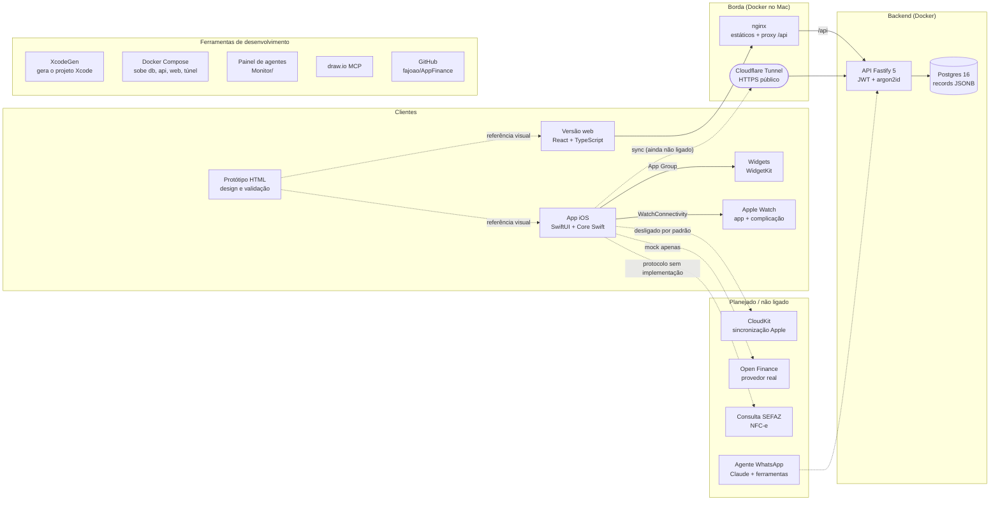
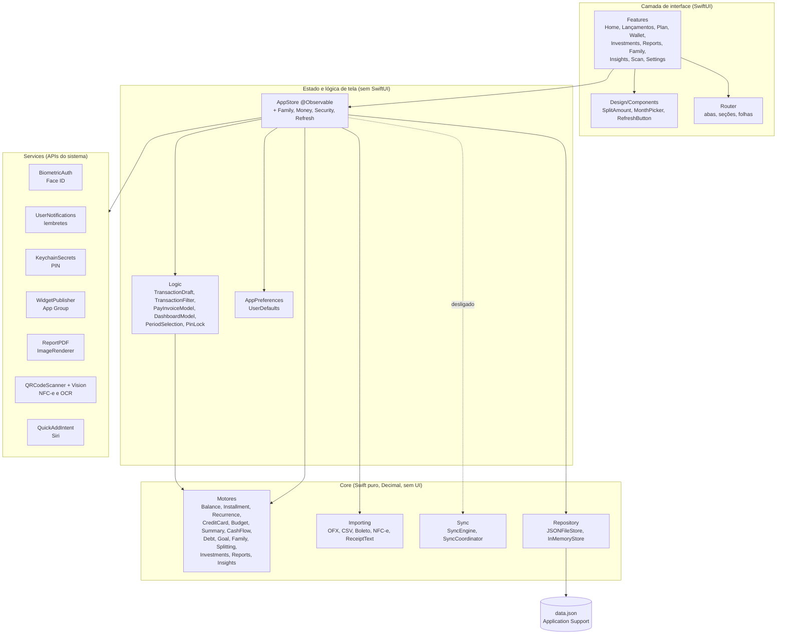
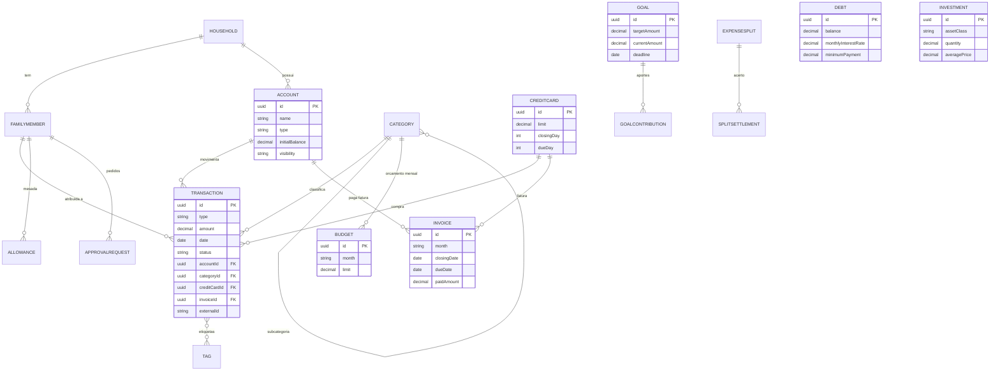
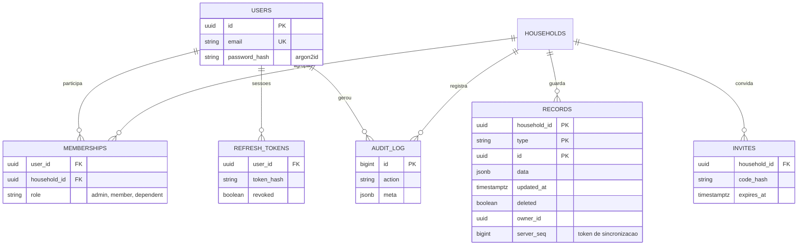
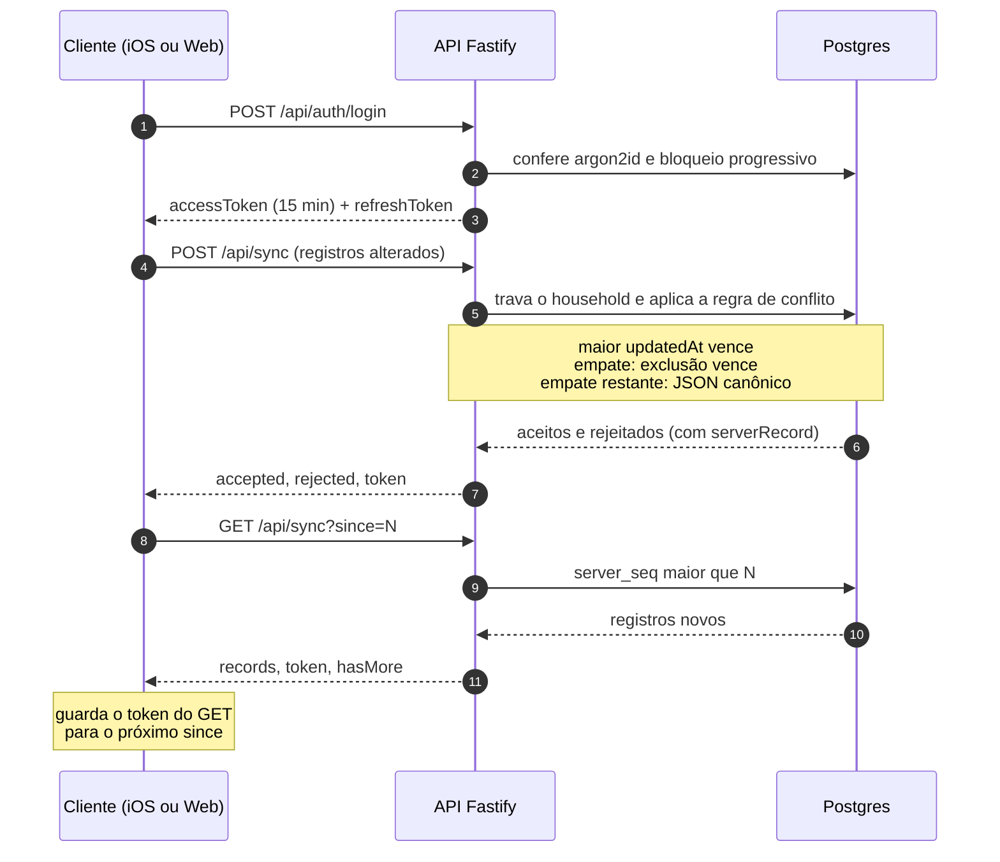
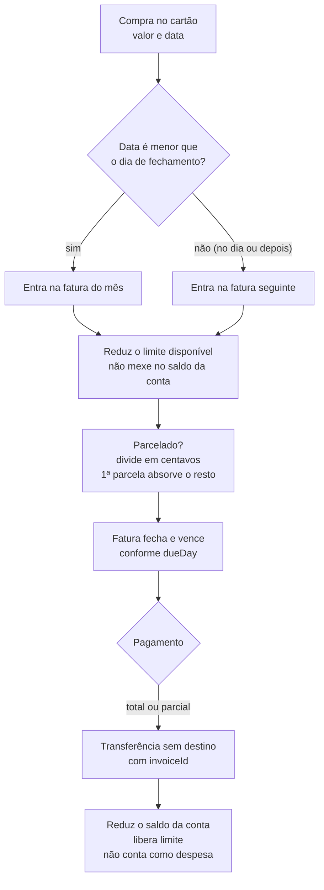
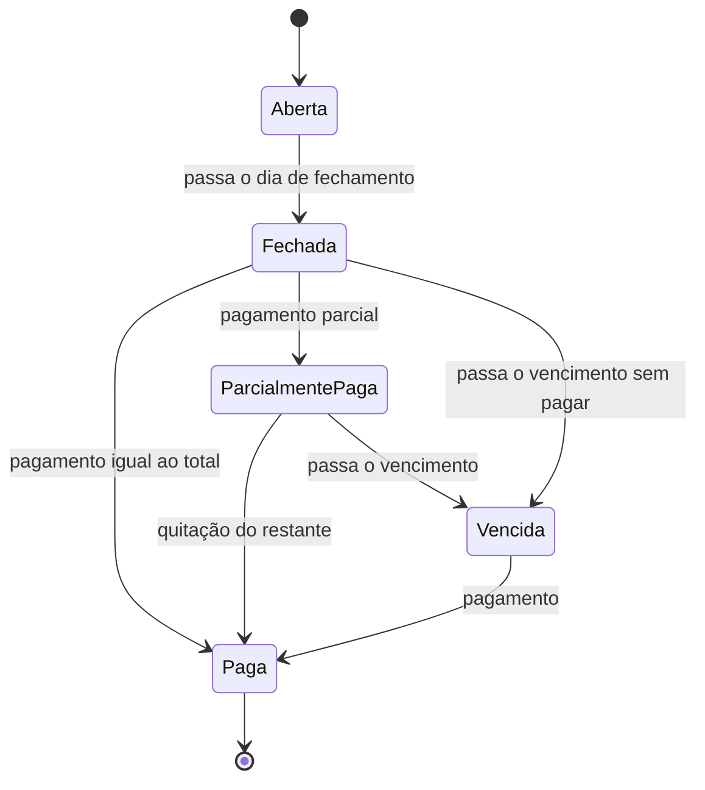
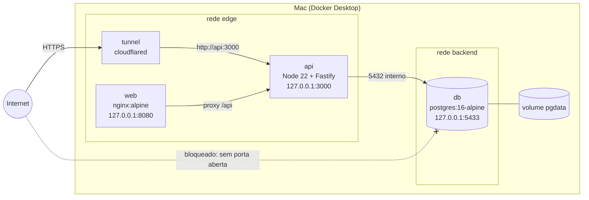
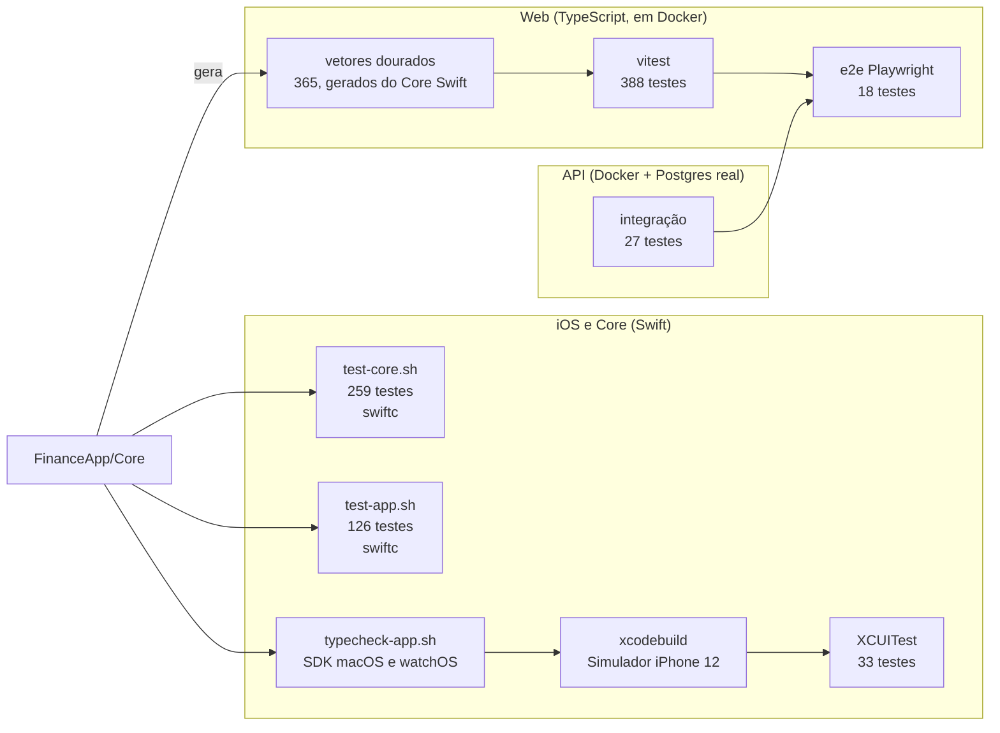
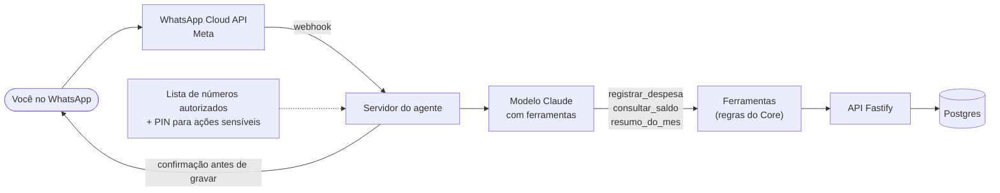

# Arquitetura da solução (diagramas Mermaid)

A arquitetura formal, no **modelo C4**, está em [`docs/arquitetura/`](arquitetura/README.md). Os diagramas abaixo complementam com visões que o C4 não cobre (modelo de dados, sincronização, fatura de cartão, pipeline de testes). O desenho editável está em
[`docs/arquitetura/arquitetura-solucao.drawio`](arquitetura/arquitetura-solucao.drawio) (abra em [app.diagrams.net](https://app.diagrams.net)).

**Legenda:** linha cheia = existe e foi testado; linha tracejada = planejado ou ainda não ligado.

## 1. Visão geral da solução

## 2. Camadas do app iOS

## 3. Modelo de dados do Core

## 4. Modelo de dados do banco (Postgres)

## 5. Sincronização (push e pull)

## 6. Compra no cartão e pagamento da fatura

## 7. Implantação com Docker Compose

## 8. Pipeline de verificação

## 9. Agente por WhatsApp (planejado)

Ainda não existe. O desenho abaixo é a recomendação para a próxima etapa, depois que o app iOS sincronizar com a API.

