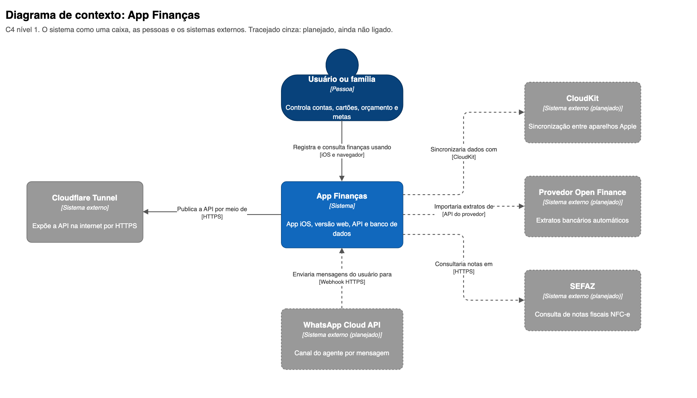
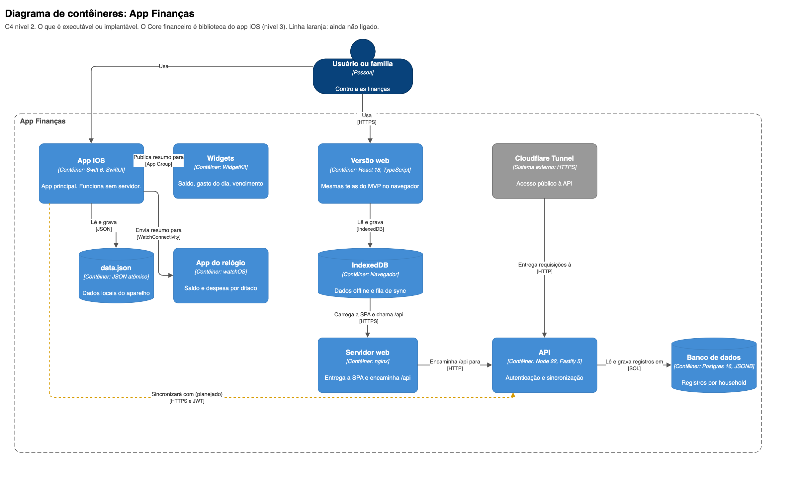
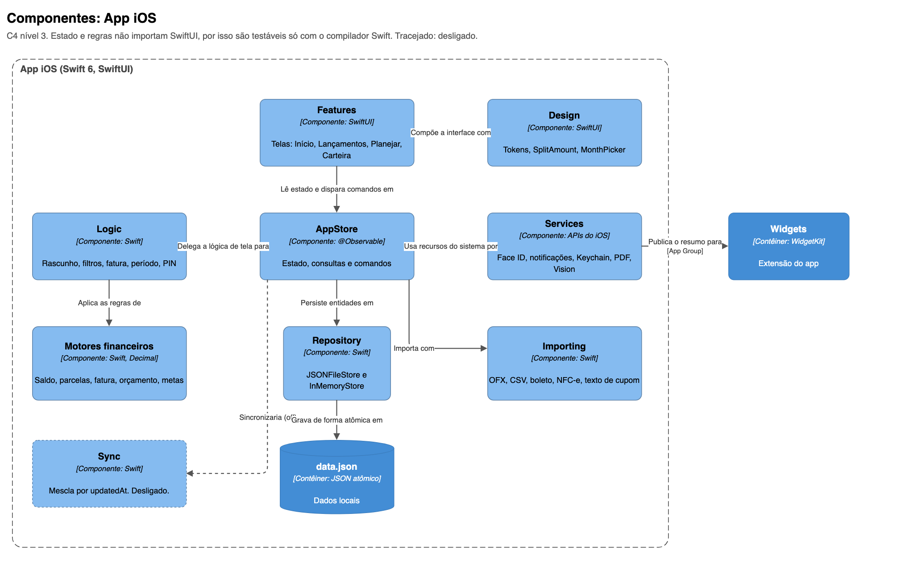
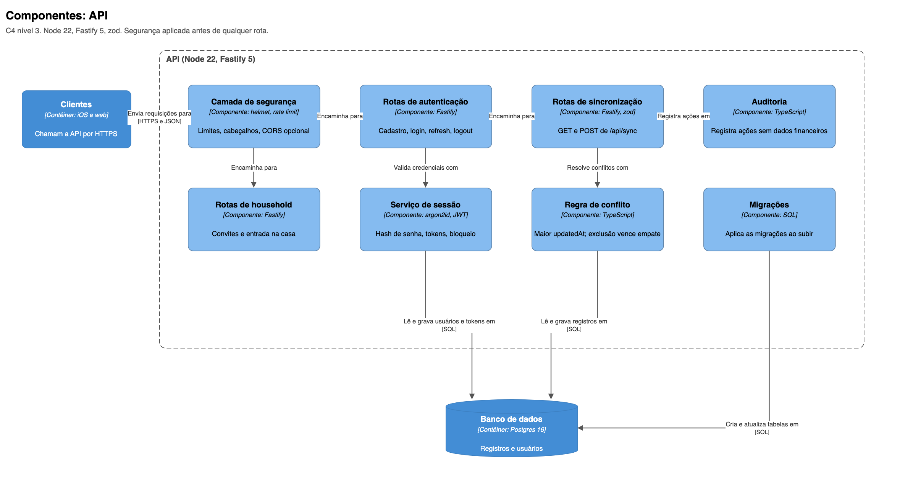
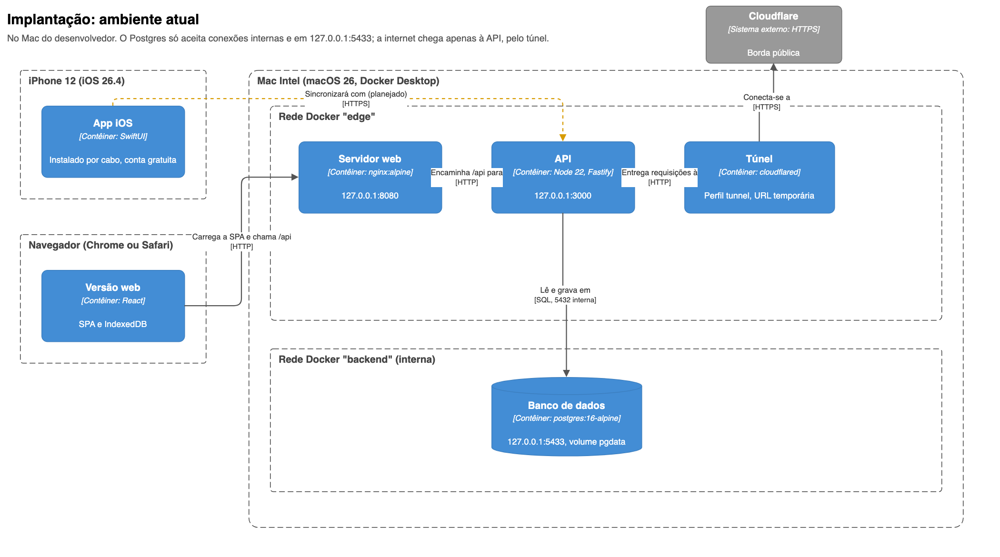
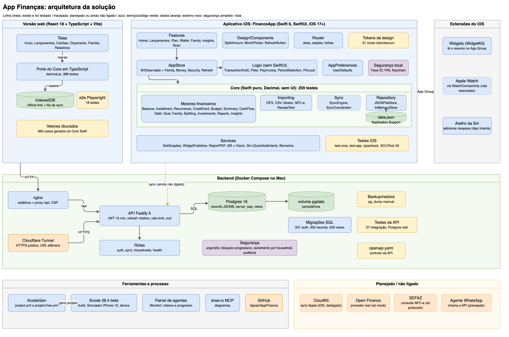

# Arquitetura (modelo C4)

Os diagramas seguem o [modelo C4](https://c4model.com), em Mermaid, e são renderizados pelo GitHub. Comece pelo nível 1 e desça só até o nível de detalhe de que precisar.

| Nível | Arquivo | Para quem |
|---|---|---|
| 1. Contexto | [c4-contexto.md](c4-contexto.md) | Todos |
| 2. Contêineres | [c4-containers.md](c4-containers.md) | Técnicos |
| 3. Componentes do app iOS | [c4-componentes-ios.md](c4-componentes-ios.md) | Desenvolvedores |
| 3. Componentes da API | [c4-componentes-api.md](c4-componentes-api.md) | Desenvolvedores |
| Implantação | [c4-implantacao.md](c4-implantacao.md) | Operação |
| Dinâmico: sincronização | [c4-dinamico-sincronizacao.md](c4-dinamico-sincronizacao.md) | Técnicos |

## Desenhos (draw.io)

O arquivo [arquitetura-solucao.drawio](arquitetura-solucao.drawio) tem uma página por nível do C4 e uma página com a visão geral completa. Abra em [app.diagrams.net](https://app.diagrams.net). As imagens abaixo são a exportação de cada página.

**1. Contexto**

**2. Contêineres**

**3. Componentes do app iOS**

**3. Componentes da API**

**Implantação**

**Visão geral completa (tudo em uma página)**

Outros diagramas (modelo de dados, fatura de cartão, pipeline de testes, agente de WhatsApp) estão em [../arquitetura.md](../arquitetura.md).

## Convenções

- **Contêiner** é algo implantável ou executável (app, API, banco). Uma biblioteca compartilhada, como o `Core`, **não** é contêiner: ela aparece como componente do app iOS.
- Setas são unidirecionais e têm um verbo e a tecnologia.
- "(planejado)" marca o que ainda não está ligado.
