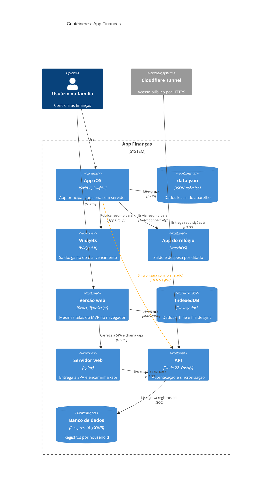

# C4 nível 2: contêineres

Mostra o que é implantável ou executável dentro do App Finanças e como as partes se falam. O núcleo financeiro (`Core`) é uma biblioteca compilada dentro do app iOS, então aparece no nível de componentes, não aqui.

**Estado:** a linha do app iOS para a API ainda não está ligada. Hoje o app iOS guarda os dados só no aparelho.

