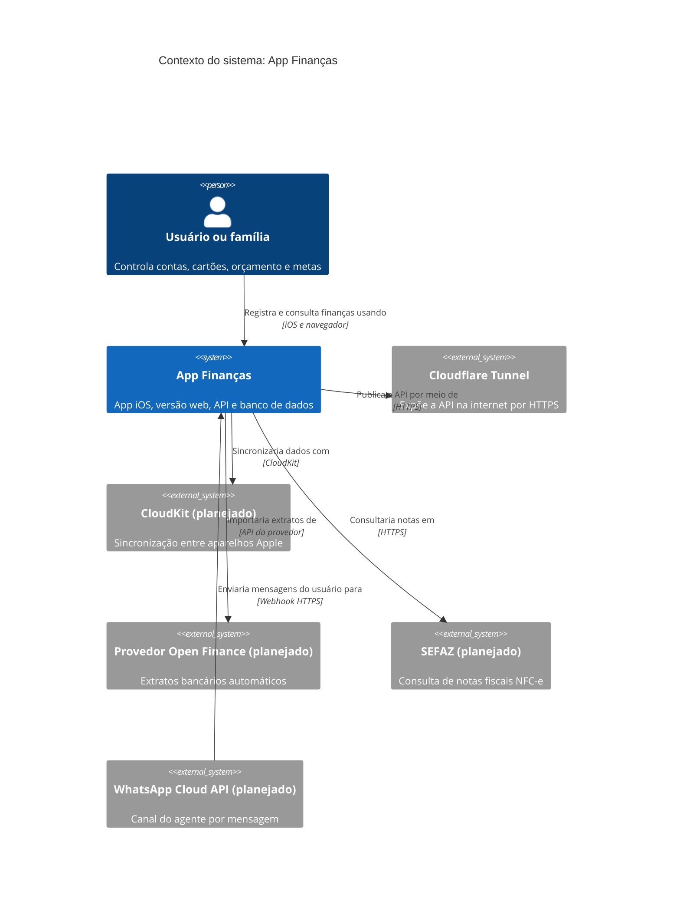

# C4 nível 1: contexto do sistema

Mostra o App Finanças como uma caixa só, as pessoas que o usam e os sistemas externos com os quais ele conversa. É o diagrama para qualquer público.

**Legenda:** itens marcados "(planejado)" ainda não estão ligados. O que existe e foi testado não tem marca.

