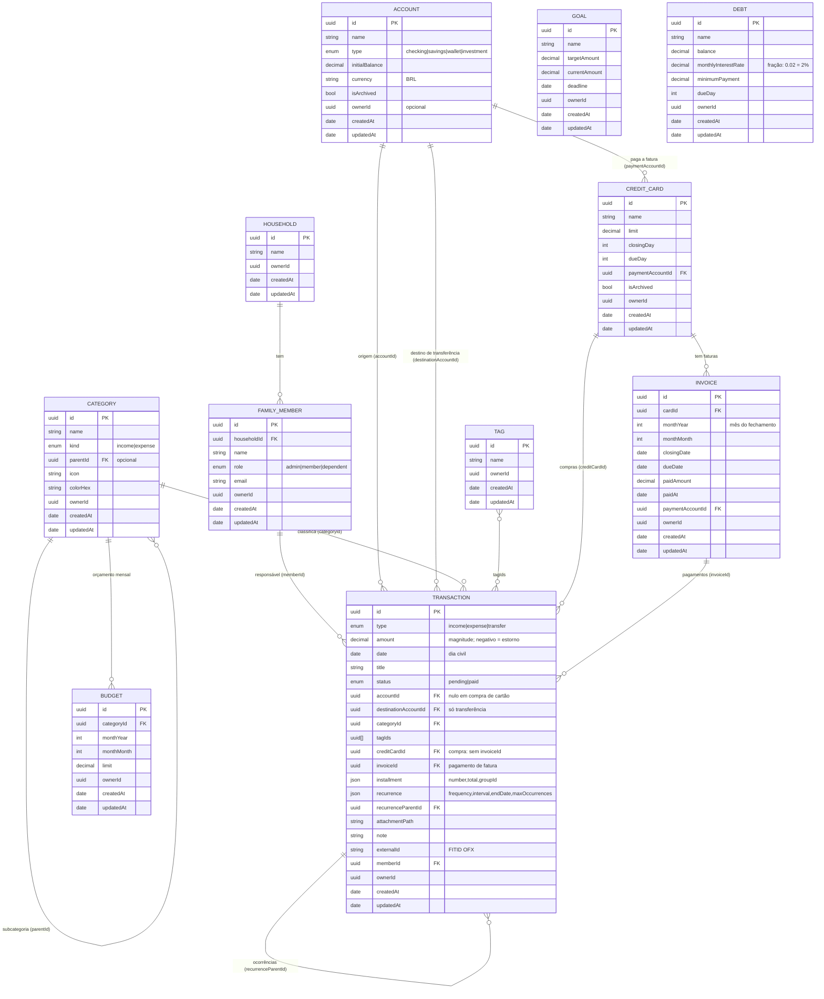
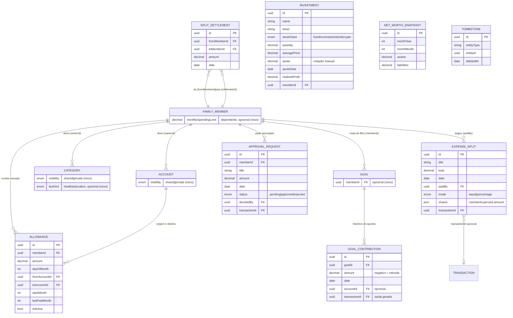

# Diagrama ER - App Finanças

Modelo de dados do Core (`FinanceApp/Core/Models.swift`). Todas as entidades têm `id` (UUID), `createdAt`, `updatedAt` e `ownerId` (UUID opcional, reservado para multiusuário/CloudKit). Dinheiro é sempre `Decimal` (no SwiftData/CloudKit, armazenar como `Decimal` ou inteiro em centavos).

## Regras de modelagem

- **Fatura**: `Invoice` só é persistida quando há pagamento. O total vem das compras do cartão cujo `date` cai no ciclo (compra no dia do fechamento ou depois vai para a fatura seguinte). `monthYear/monthMonth` representam o mês de **fechamento** (`YearMonth` no código).
- **Compra no cartão**: `Transaction` com `creditCardId` e sem `invoiceId`; não altera saldo de conta, consome limite.
- **Pagamento de fatura**: `Transaction` do tipo `transfer` com `accountId` (conta pagadora), sem `destinationAccountId`, com `creditCardId` e `invoiceId`. Reduz o saldo da conta, libera limite e não conta como despesa nos relatórios.
- **Transferência entre contas**: `type = transfer` com `accountId` e `destinationAccountId`; não entra em receitas/despesas.
- **Parcelas**: cada parcela é uma `Transaction` própria; `installment.groupId` une as parcelas da mesma compra. A última absorve o resto de centavos.
- **Recorrência**: o lançamento modelo guarda `recurrence`; as ocorrências geradas apontam para ele por `recurrenceParentId`.
- **Importação**: `externalId` (FITID do OFX) evita duplicar lançamentos.
- **Sincronização futura**: ids UUID, `updatedAt` para resolução de conflitos (último vence) e `ownerId` para multiusuário/CloudKit.
- **Persistência atual**: `FinanceSnapshot` (JSON, `JSONFileStore`) com um array por entidade.

## Fase 2 (v1): novas entidades e campos

Definidos em `FinanceApp/Core/Models.swift` (campos novos) e `FinanceApp/Core/ModelsPhase2.swift` (entidades novas).
Arquivos antigos continuam válidos: `FinanceSnapshot` e os modelos alterados decodificam com valores padrão quando faltam campos.

Regras:
- **Privacidade**: `visibility = private` + `ownerId` = membro dono. Só o dono enxerga, em qualquer visão. Itens sem dono e compartilhados valem para todos.
- **Aporte em meta**: `GoalContribution` registra o aporte; a saída da conta é um `Transaction` do tipo transferência sem destino (`transactionId` liga os dois para desfazer juntos).
- **Divisão de despesas**: saldo de cada membro = o que pagou − a sua parte, ajustado pelos `SplitSettlement`. O acerto minimiza transferências.
- **Mesada**: gera transferências `Transaction` (origem → conta do dependente) com `memberId` do dependente; `lastPaidMonth` evita pagar duas vezes.
- **Patrimônio**: um `NetWorthSnapshot` por mês (o mais recente substitui). Passivos = dívidas + limite usado dos cartões + saldos negativos de contas.
- **Sincronização**: `Tombstone` registra exclusões para o merge por `updatedAt`; `FinanceSnapshot.version` passa a 2.
